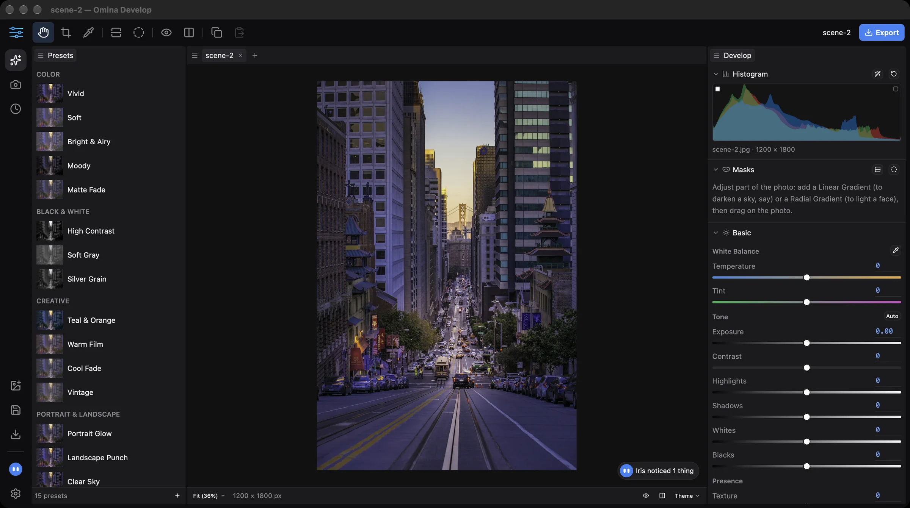
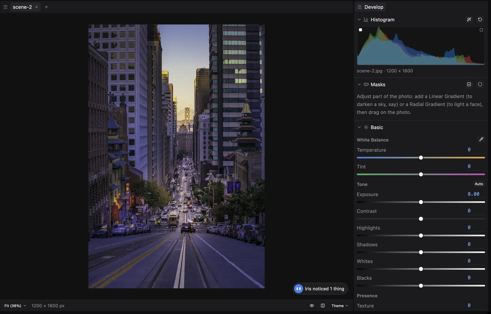

<div align="center">


# Omina Develop

**Non-destructive photo editing.**<br>
Get the light and color right, and keep the original.

[](https://github.com/OddOmens/Omina-Develop/releases/latest)
[](LICENSE)


**Download:**
[macOS](https://github.com/OddOmens/Omina-Develop/releases/latest/download/Omina-Develop-macOS.dmg) ·
[Windows](https://github.com/OddOmens/Omina-Develop/releases/latest/download/Omina-Develop-Windows-Setup.exe) ·
[Linux](https://github.com/OddOmens/Omina-Develop/releases/latest/download/Omina-Develop-Linux.AppImage)
&nbsp;|&nbsp; [Release notes](https://github.com/OddOmens/Omina-Develop/releases)

<br>



</div>

<br>

Omina Develop is photo editing in the style of Lightroom. Each photo opens in its own tab with its own
undo history, and your edits are saved in a project that keeps a copy of the original, so the photo
itself is never changed.

Part of the Omina family, with [Omina Edit](https://github.com/OddOmens/Omina-Edit) for photo editing and
design, and [Omina Motion](https://github.com/OddOmens/Omina-Motion) for video and motion graphics.

## Contents

- [What it does](#what-it-does)
- [Install](#install)
- [Privacy](#privacy)
- [Build from source](#build-from-source)
- [License](#license)

## What it does

| | |
|---|---|
| ☀️ **Light and color** | White balance, tone, presence, a tone curve, color mixer, color grading, detail and effects. |
| 🎨 **Presets with previews** | Live thumbnails for every preset; point at one to try it on your photo. |
| 📐 **Crop and straighten** | Level finds the tilt from the photo's own lines. |
| 🌗 **Masks** | Linear and radial gradients to work on part of a photo. |
| 🔁 **Compare and undo** | Before and after, snapshots, a full history and a clipping warning. |
| 📋 **Share the look** | Copy and paste settings between photos, or apply a preset to a whole folder. |
| 💬 **Iris** | A built-in helper that looks over each photo for things like blown highlights, a color cast or crushed shadows, explains what it measured, and fixes it in a click. You can also ask in words ("shadows +30", "a bit warmer"). It follows plain rules, not AI, and can be turned off. |
| 🔀 **Hand off** | Send a photo to Omina Edit or Omina Motion, and open what comes back in a tab. |
| 📤 **Export** | JPEG, PNG, TIFF, WebP and BMP, at full resolution, with export presets. |

<p align="center">
  
  <br><sub>Histogram, masks, white balance and tone beside the photo.</sub>
</p>

### Projects

Edits are saved as **`.omid`** projects, which open in Omina Develop with a double-click. Each one holds
your settings, the original photo byte for byte, and a preview. Projects saved with the older `.develop`
extension still open.

## Install

Download the file for your system from the [latest release](https://github.com/OddOmens/Omina-Develop/releases/latest).

| System | Needs | First launch |
|---|---|---|
| **macOS** | macOS 13 or later, Apple silicon | The app isn't signed with an Apple Developer ID yet, so macOS asks once. Open the app, close the warning, then go to **System Settings ▸ Privacy & Security** and choose **Open Anyway**. |
| **Windows** | Windows 10 or 11, 64-bit | The installer isn't signed yet, so Windows may warn you. Choose **More info**, then **Run anyway**. |
| **Linux** | A 64-bit (x86-64) desktop | Make the AppImage executable (`chmod +x`, or **Properties ▸ Permissions**), then open it. |

## Privacy

Omina Develop works entirely offline. It has no accounts, telemetry or analytics, and your photos never
leave your computer.

## Build from source

You need [Rust](https://rustup.rs). Omina Develop shares Iris with Omina Motion, so check both out side by side:

```bash
mkdir "Omina Studio" && cd "Omina Studio"
git clone https://github.com/OddOmens/Omina-Develop.git "Omina Develop"
git clone https://github.com/OddOmens/Omina-Motion.git "Omina Motion"
cd "Omina Develop"
```

```bash
cargo run -p develop --release   # run the app
cargo test --workspace           # run every test
```

The [developer guide](docs/ARCHITECTURE.md) explains how the code is organized and the conventions it follows.
Pushing a version tag (`v1.2.3`) builds the macOS, Windows and Linux installers and attaches them to that release.

## License

Omina Develop is free software under the [GNU General Public License, version 3 or later](LICENSE).
